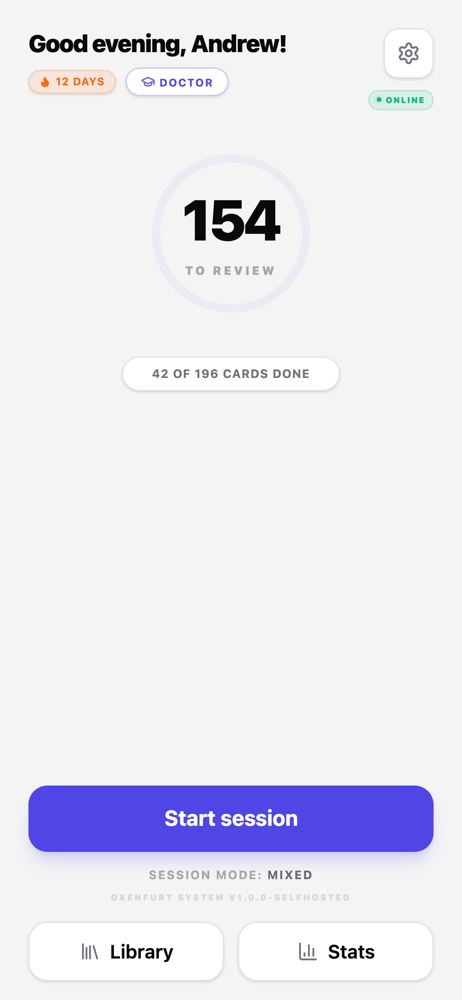

# Oxenfurt

> A self-hosted Telegram Mini App that turns transcripts of your live
> language lessons into spaced-repetition flashcards — and lets an AI
> agent answer the questions you couldn't ask your tutor in time.

<!-- screenshot:hero — replace with apps/mini-app + Telegram chat side by side -->
<p align="center">
  
</p>

Named after [Oxenfurt Academy](https://witcher.fandom.com/wiki/Oxenfurt_Academy)
from *The Witcher* — the city where everyone goes to learn.

---

## Why

You're learning a language with a tutor. You finish a Zoom call with
forty minutes of useful new vocabulary in your head and exactly zero
of it written down. By the time you get to Anki the next morning, half
of it is gone.

Oxenfurt closes that loop. The transcript of your lesson goes to an
agent (Hermes, or anything OpenAI-compatible) that pulls out the
vocabulary, fixed expressions, and grammar points you actually
discussed — not what a textbook *thinks* you should know — and posts
them to the backend as cards.

Then you open the bot. The Mini App schedules them with **FSRS-5**,
quizzes you in five different ways, and lets you flag confusing cards
for the agent to explain after the session. No screen-switching, no
new account, no app store install.

---

## Features

**Card review** — five modes, one queue
- **Recognition** — tap to flip, rate Again / Hard / Good / Easy
- **Cloze** — gap-fill from the lesson's actual context sentence
- **Translation** — type the foreign-language form from the native one
- **Listening** — TTS pronounces the term, you type what you hear
- **Mixed** — variant picked deterministically per card

Plus: undo window after every rating, mid-session pause/resume, opt-in
in-session retry for failed cards, swipe gestures, optional voice answer
on top of typed (Web Speech API where the WebView allows).

**Polyglot from day one** — pick any of nine target languages in
Settings (English, Spanish, German, French, Italian, Portuguese,
Japanese, Chinese, Korean). TTS voice, translation pair, and on-card
microcopy follow. UI itself ships in English + Russian; both auto-
detect from your Telegram locale.

**Card management**
- Library with filters by type (word / phrase / theory), status, lesson
  source; full-text search across term, translation, question.
- Edit any card in place from the back of the flashcard — no detour.
- Cross-references: tap the layers icon to see other cards from the
  same lesson.

**Stats** — today / week / month review counts, accuracy, forecast
("12 due now, 23 in the next 24h"), GitHub-style 6-month heatmap,
session history, and *Academy Relics* (achievements with Witcher-flavoured
names — purely decorative).

**Agent integration** — ask a question about any card ("when's this
appropriate?"), the agent picks it up async with full lesson context,
writes back a Markdown explanation, optionally adds reinforcement
cards via the existing ingest pipeline. See [the agent skill spec](deploy/hermes/skills/oxenfurt_answer_questions.md).

**Optional AI semantic grading** — when fuzzy match disagrees with
your typed answer, an opt-in "🤖 Check meaning" button asks the LLM
for a second opinion. Provider-agnostic via the OpenAI Chat Completions
API — works with Anthropic, Moonshot/Kimi, Together, Groq, OpenRouter,
or any local Ollama.

---

## See it work

<!-- screenshot:home -->
<p align="center">
  
  
  
</p>

<p align="center">
  
  
</p>

<!-- video:demo -->
<p align="center">
  <a href="docs/screenshots/demo.mp4">▶ 30-second demo (MP4)</a>
</p>

---

## Quick start

On a fresh Ubuntu/Debian VPS, as root:

```bash
curl -fsSL https://raw.githubusercontent.com/mdfr11/oxenfurt/master/deploy/install.sh | bash
```

> First-time fresh? Append **`--with-demo`** to seed ~30 example cards
> across three demo lessons — instant non-empty dashboard:
> `… | bash -s -- --with-demo`

You'll need:

1. **A Telegram bot** — create one with [@BotFather](https://t.me/BotFather).
   Save the token, you'll paste it into the installer.
2. **Your Telegram user id** — DM [@userinfobot](https://t.me/userinfobot)
   and copy the number.
3. **A domain pointed at the VPS** — anything with an A record works.
   [DuckDNS](https://www.duckdns.org/) gives you `yourname.duckdns.org`
   for free.
4. **An email** — Let's Encrypt sends expiry notices here.

The installer asks for these four, generates app secrets itself,
installs prereqs (Bun, pnpm, Postgres, Caddy, ufw), builds the app,
runs migrations, sets up systemd, and brings the service up. End to
end on a clean VPS: ~3-5 minutes.

After it finishes, set the bot's **Menu Button** to your domain via
`@BotFather` → *Bot Settings* → *Menu Button*. Open the bot in
Telegram, tap the menu, app opens. Done.

> For a step-by-step manual deployment (or to hand off to an
> agent on the VPS), see [`deploy/AGENT_GUIDE.md`](deploy/AGENT_GUIDE.md).

---

## How it works

```
                          internet
                              │
                       ┌──────▼──────┐
                       │    Caddy    │  443/TCP, auto-TLS Let's Encrypt
                       └──┬───────┬──┘
                          │       │
         /api/* (proxy)   │       │   /, /assets/* (static)
                          │       │
              ┌───────────▼─┐  ┌──▼──────────────────┐
              │  oxenfurt-  │  │ /opt/oxenfurt/      │
              │  backend    │  │   mini-app/         │
              │  127.0.0.1: │  │   (Vite static dist)│
              │  3000       │  └─────────────────────┘
              └─────┬───────┘
                    │ loopback
                    │
              ┌─────▼─────────────┐
              │  Postgres 17      │  127.0.0.1:5432
              └─────▲─────────────┘
                    │
                    │ POST /ingest/cards (loopback + Bearer)
                    │
              ┌─────┴───────────┐
              │  Hermes Agent   │  optional — any OpenAI-compatible LLM
              │  (or your own)  │  works as a card source
              └─────────────────┘
```

Everything but Caddy binds to `127.0.0.1`. The Mini App and backend
share a single origin (Caddy reverse-proxies `/api/*`), so the browser
never has to handle CORS. Cards land in Postgres, FSRS state is stored
as flat columns (no JSONB for hot fields), and the per-type payload
lives in a single `payload` jsonb column — schema enforcement via
Valibot at every boundary.

---

## Stack

| Layer | Choice |
|-------|--------|
| Runtime | **Bun 1.3** (single binary, fast cold start) |
| HTTP | **Hono** |
| ORM | **Drizzle** + `postgres-js` |
| Database | **Postgres 17** |
| Validation | **Valibot** (chosen over Zod for bundle size — every byte counts in a Mini App) |
| Frontend | **React 19** + **Vite** + **TanStack Query** + **Tailwind** + **Framer Motion** |
| Telegram | **`@telegram-apps/sdk-react` v3** |
| Spaced repetition | **`ts-fsrs` 5.x** (FSRS-5) |
| Reverse proxy | **Caddy** (auto-TLS) |
| Auth | **`jose`** for JWT (HS256), `crypto.timingSafeEqual` for Telegram initData HMAC |
| Workspace | **pnpm 10** |
| Tests | **`bun test`** — unit + Postgres-integration |
| CI | GitHub Actions with a real Postgres 17 service container |

---

## Local development

Requires **Bun 1.3+**, **pnpm 10+**, **Node 22+**, and **Docker** (for
a local Postgres container).

```sh
pnpm install
docker compose up -d postgres

cp apps/backend/.env.example apps/backend/.env
# Fill BOT_TOKEN, JWT_SECRET (≥32 chars), INGEST_TOKEN,
# OWNER_TELEGRAM_USER_ID, plus ENABLE_DEV_AUTH=true for dev.

# Backend — auto-reloads on save
cd apps/backend && bun --watch src/index.ts

# Mini App — in another terminal
cd apps/mini-app && pnpm dev

# Everything
pnpm typecheck && pnpm test
```

The Mini App opens at <http://localhost:5173>. In dev mode it fetches
`/auth/dev-token` from the backend and skips Telegram HMAC validation,
so you can iterate on the UI without re-issuing initData every time.
(The backend refuses to boot with `ENABLE_DEV_AUTH=true` and
`NODE_ENV=production`.)

---

## Optional: hooking up an agent

Oxenfurt works fine with no agent — you can POST cards yourself:

```sh
curl -X POST https://YOUR_DOMAIN/api/ingest/cards \
  -H "Authorization: Bearer $INGEST_TOKEN" \
  -H "Content-Type: application/json" \
  -d '{
    "cards": [{
      "type": "vocab",
      "payload": {
        "term": "pragmatic",
        "translation": "прагматичный",
        "context_sentence": "We need a more pragmatic approach.",
        "context_term_start": 13,
        "context_term_end": 22
      },
      "source": "lesson-2026-05-15"
    }]
  }'
```

If you already run a Hermes Agent for transcript ingestion, drop the
skill files in `deploy/hermes/skills/` into your Hermes config and
set `OXENFURT_INGEST_TOKEN` + `OXENFURT_API_URL` in its env. See
[`deploy/hermes/integration.md`](deploy/hermes/integration.md) for
the wiring.

Building your own ingest source? The contract is in
[`deploy/hermes/skills/oxenfurt_ingest.md`](deploy/hermes/skills/oxenfurt_ingest.md)
— it's a plain-Markdown LLM-skill file but the schema and rules apply
to any caller.

---

## Optional: AI semantic grading

When fuzzy match says you're wrong but you think you're right (e.g.
*"I want to leave"* vs the expected *"I want to go away"*), the
opt-in **🤖 Check meaning** button asks an LLM. Toggle it on in
Settings → AI grading.

Configure the provider via three env vars on the backend:

```env
LLM_API_BASE_URL=https://api.moonshot.cn/v1
LLM_API_KEY=sk-...
LLM_MODEL=moonshot-v1-8k
```

Any OpenAI-compatible Chat Completions endpoint works: Anthropic,
Moonshot/Kimi, Together, Groq, OpenRouter, or a local **Ollama**
(`http://127.0.0.1:11434/v1`, model `qwen2.5:3b`). Leave the vars
unset to disable AI features cleanly — the endpoint returns
`503 llm_not_configured` and the toggle in Settings has no visible
effect.

Cost in practice: 1-2 calls per session at most, ~$0.0002 each on a
Haiku-class model.

---

## Project layout

```
apps/
  backend/        Bun + Hono + Drizzle + Postgres practice service
  mini-app/       Vite + React 19 + Telegram SDK Mini App
packages/
  shared/         Valibot schemas, FSRS wrapper, fuzzy-match
deploy/
  install.sh        ⭐ One-shot installer for fresh VPS
  vps-setup.sh      Prereqs bootstrap (used by install.sh)
  deploy.sh         Dev-side rsync + restart (after install)
  README.md         Operator-facing deployment guide
  AGENT_GUIDE.md    Stage-by-stage plan for autonomous agents
  systemd/          Unit files for backend + nightly pg_dump
  Caddyfile         Reverse-proxy + static host template
  hermes/           Skill files for the optional Hermes agent
  env/              .env templates
docs/
  screenshots/      (your screenshots go here)
```

---

## Status & roadmap

This is a single-user side project that someone else might find
useful as a starting point. It's stable for daily use by its author
(every commit gets dogfooded), but treat anything beyond *"clone it
and learn from the code"* as best-effort.

Things on the radar that might or might not happen:
- Voice input via MediaRecorder + Whisper on the backend (current
  Web Speech path doesn't work in Telegram WebView on Android)
- A reference Python ingester for users who don't have Hermes
- "Found in the wild" tracker — counter per card for moments you
  actually heard the word outside practice
- Self-explanation prompt on "Hard" ratings

If you fork it, ping me — happy to look at PRs.

---

## License

[MIT](LICENSE). Use it however you want.

## Acknowledgements

- **FSRS** algorithm by [Jarrett Ye](https://github.com/open-spaced-repetition/fsrs4anki),
  [`ts-fsrs`](https://github.com/open-spaced-repetition/ts-fsrs) implementation.
- **Telegram Mini Apps SDK** by [`@telegram-apps`](https://github.com/Telegram-Mini-Apps).
- **Hermes** agent framework by [NousResearch](https://nousresearch.com/).
- **Oxenfurt** name from *The Witcher* by Andrzej Sapkowski / CD Projekt RED — no affiliation, just affection.
